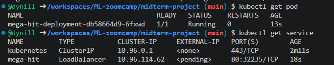
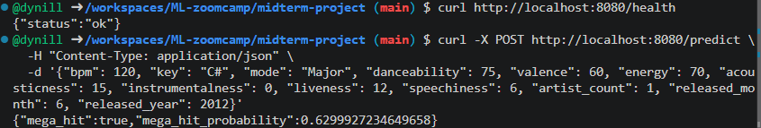

# Mega-Hit Prediction: What Makes a Song a Streaming Mega-Hit?

A machine learning midterm project that predicts whether a song is a **mega-hit**, meaning it sits in the top 25% by stream count among the most streamed Spotify songs of 2023. The model is served as a web service (Flask + gunicorn) in Docker and on a local Kubernetes cluster.

**Headline finding:** the final model reaches a test ROC AUC of **0.89**, but almost all of that comes from the song's **release year**. Using only musical characteristics, every model performs no better than chance.

## Contents
1. [Problem description](#1-problem-description)
2. [Dataset](#2-dataset)
3. [Exploratory data analysis](#3-exploratory-data-analysis-summary)
4. [Modeling](#4-modeling)
5. [Project structure](#5-project-structure)
6. [How to run](#6-how-to-run)
7. [API usage](#7-api-usage)
8. [Kubernetes deployment (local cluster)](#8-kubernetes-deployment-local-cluster)

## 1. Problem description

**What we predict.** Given a song's musical characteristics (BPM, danceability, energy, valence, acousticness, instrumentalness, liveness, speechiness, key, mode) and release information (release year, release month, number of credited artists), the model estimates the probability that the song is a mega-hit.

**Why it matters.** Streaming success is hard to explain. This project asks what separates the biggest hits from other hits, and how much of that is the music itself versus timing and release details. Labels, curators, and analysts could use the answer as a starting point for deciding what deserves attention.

**How it is used.** A prototype web service accepts a song's features as JSON and returns a mega-hit probability and a yes/no label (threshold 0.35).

**Important caveats.**
- Every song in the dataset is already a hit, so the model learns what separates *bigger* hits from smaller ones, not hits from flops.
- Older songs have had more time to accumulate streams. Release year turns out to dominate the prediction (see below), so new songs almost always score low. The service shows what separates mega-hits in this dataset; it is not a predictor of future hits.

## 2. Dataset

- **Source:** [Most Streamed Spotify Songs 2023](https://www.kaggle.com/datasets/nelgiriyewithana/top-spotify-songs-2023) (Kaggle; see the dataset page for its license). 953 songs, 24 columns.
- **Data in this repo:** the notebook downloads the dataset from Kaggle with `kagglehub`. `data/spotify-2023.csv` is a copy of that file, read by `train.py`.
- **Cleaning:** column names lowercased and simplified; one malformed `streams` value and duplicate tracks removed (953 → 948 songs); 95 missing `key` values filled with `Unknown`.
- **Target:** `mega_hit = 1` if `streams` is at or above the 75th percentile (about 25% of songs).
- **Features used:** `bpm`, `danceability`, `valence`, `energy`, `acousticness`, `instrumentalness`, `liveness`, `speechiness`, `key`, `mode`, `artist_count`, `released_month` (treated as a category), `released_year`.
- **Deliberately excluded:** playlist and chart counts (consequences of popularity, not causes), `streams` itself, track and artist names, and `released_day` (no signal).
- **Split:** 60/20/20 train/validation/test: 568 / 190 / 190 songs.

## 3. Exploratory data analysis (summary)

The full analysis, with plots, is in [`notebook.ipynb`](notebook.ipynb). The numbers below come from the training and validation data (758 songs); the test set was not used for EDA.

- About 25% of songs are mega-hits, so accuracy alone is misleading (always predicting "not a mega-hit" scores 74%).
- **Release year is by far the strongest feature** (single-feature ROC AUC about 0.84). The mega-hit rate is 65.5% for songs released up to 2015, 68.3% for 2016-2019, 35.7% for 2020-2021, 9.2% for 2022, and 1.4% for 2023.
- Fewer credited artists goes with a higher mega-hit rate (correlation -0.145).
- Speechiness (-0.125), danceability (-0.115), and valence (-0.095) show small negative correlations. Part of this is likely the year trend, since newer songs are more danceable and speechier in this data.
- BPM, energy, liveness, instrumentalness, acousticness, and release day show no detectable relationship with the target (p > 0.18). Neither do `key` and `mode` (chi-square p = 0.48 and 0.72).
- Release month is statistically related to the target, but it is entangled with release year: 2023 songs only cover January to July and are almost never mega-hits.

## 4. Modeling

**Metric.** ROC AUC (the probability that a random mega-hit gets a higher score than a random non-hit): it doesn't depend on a threshold and works with the 25/75 class imbalance. Accuracy, precision, recall, and the confusion table are reported for the final model.

**Models and tuning.** Four models were tuned on the validation set, one parameter at a time, using the full feature set:

| Model | Tuned parameters | Chosen |
|---|---|---|
| Logistic regression (with `StandardScaler`) | `C` | 1 (all values scored about 0.61) |
| Decision tree | `max_depth`, `min_samples_leaf` | 4, 15 |
| Random forest | `max_depth`, `min_samples_leaf`, `n_estimators` | 8, 5, 150 |
| XGBoost | `max_depth`, `eta`, `min_child_weight`, number of rounds | 2, 0.1, 1, 25 |

**Validation ROC AUC by feature set** (A: music only; B: A + artist count and release month; C: B + release year):

| Model | A: music only | B: + artist count, month | C: + release year |
|---|---|---|---|
| Decision tree | 0.450 | 0.588 | 0.859 |
| Logistic regression | 0.423 | 0.568 | 0.613 |
| Random forest | 0.489 | 0.575 | 0.809 |
| XGBoost | 0.479 | 0.584 | **0.863** |

- Music alone scores at chance (0.42 to 0.49). Release year is what makes the models work.
- Logistic regression stays near 0.61 because the year effect is not a straight line (the tree models find thresholds, such as a split around 2020).
- The validation set has only about 42 mega-hits, so differences of a few AUC points (for example decision tree versus XGBoost) are within noise.
- Parameters were tuned on feature set C and reused for A and B, so C may be slightly favored.

**Final model:** XGBoost on feature set C, retrained on train + validation.

| Check | Result |
|---|---|
| Test ROC AUC | **0.8905** |
| Validation ROC AUC | 0.863 |
| 5-fold cross-validation AUC (train + validation) | 0.868 ± 0.013 |
| Test accuracy at threshold 0.35 | 0.811 (always predicting "not a mega-hit": 0.742) |
| Test precision / recall at threshold 0.35 | 0.62 / 0.69 |

Test confusion table at threshold 0.35 (rows: actual, columns: predicted):

| | Predicted not mega-hit | Predicted mega-hit |
|---|---|---|
| **Actual not mega-hit** | 120 | 21 |
| **Actual mega-hit** | 15 | 34 |

The threshold of 0.35 was chosen from the validation data, where precision and recall are nearly flat between 0.3 and 0.55; it favors catching more mega-hits. At 0.5 the test results are almost the same (precision 0.64, recall 0.65).

Feature importance (XGBoost gain) confirms the picture: `released_year` scores 33.4, versus 8.4 or less for every other feature.

## 5. Project structure

```
midterm-project/
├── data/spotify-2023.csv   # dataset (copy of the Kaggle file)
├── notebook.ipynb          # data prep, EDA, model selection, tuning, evaluation
├── train.py                # trains the final model and saves model.bin
├── predict.py              # Flask web service
├── model.bin               # saved DictVectorizer + XGBoost model
├── Pipfile, Pipfile.lock   # pinned dependencies
├── Dockerfile
├── kube-config/            # Kubernetes manifests
│   ├── deployment.yaml
│   └── service.yaml
├── images/                 # screenshots used in this README
└── README.md
```

Architecture: `data/spotify-2023.csv` → `train.py` → `model.bin` → `predict.py` (Flask + gunicorn) → Docker container → `POST /predict`. The same container image also runs on a local Kubernetes cluster (section 8).

## 6. How to run

The project was developed with Python 3.14 (GitHub Codespaces). Run all commands from the `midterm-project` folder. If you don't have Python 3.14, use the Docker route below, which only needs Docker.

**Get the project**
```bash
git clone https://github.com/dynill/ML-zoomcamp.git
cd ML-zoomcamp/midterm-project
```

**Install dependencies and activate the environment**
```bash
pip install pipenv
pipenv install
pipenv shell
```

**Train the model** 
```bash
python train.py
```

**Run the service locally**
```bash
python predict.py
```
The service listens on port 9696. (Without activating the environment, use `pipenv run python predict.py`.)

**Run with Docker** (`model.bin` is included in the repo)
```bash
docker build -t mega-hit-prediction .
docker run -it --rm -p 9696:9696 mega-hit-prediction
```
The first build takes a few minutes. The image uses `python:3.14-slim`, installs the locked dependencies from the Pipfile, and serves `predict.py` with gunicorn. Expected output:
```
[INFO] Starting gunicorn 27.0.1
[INFO] Listening at: http://0.0.0.0:9696 (1)
[INFO] Using worker: sync
[INFO] Booting worker with pid: 7
```

**Run the notebook**
```bash
pipenv install --dev
pipenv run jupyter notebook
```
The notebook downloads the dataset with `kagglehub` and takes several minutes to run; the random forest and XGBoost tuning loops are the slowest part.

## 7. API usage

| Endpoint | Method | Description |
|---|---|---|
| `/health` | GET | returns `{"status": "ok"}` |
| `/predict` | POST | takes a song as JSON, returns the mega-hit probability and label |

**Input fields**

| Field | Values |
|---|---|
| `bpm`, `danceability`, `valence`, `energy`, `acousticness`, `instrumentalness`, `liveness`, `speechiness` | numbers (Spotify audio features; percentages are 0 to 100, BPM roughly 65 to 206) |
| `key` | `A`, `A#`, `B`, `C#`, `D`, `D#`, `E`, `F`, `F#`, `G`, `G#`, or `Unknown` |
| `mode` | `Major` or `Minor` |
| `artist_count` | number of credited artists (1 to 7 in the data) |
| `released_month` | 1 to 12 |
| `released_year` | year (1930 to 2023 in the data) |

**Example request**
```bash
curl -X POST http://localhost:9696/predict \
  -H "Content-Type: application/json" \
  -d '{"bpm": 120, "key": "C#", "mode": "Major", "danceability": 75, "valence": 60, "energy": 70, "acousticness": 15, "instrumentalness": 0, "liveness": 12, "speechiness": 6, "artist_count": 1, "released_month": 6, "released_year": 2012}'
```

**Response**
```json
{"mega_hit": true, "mega_hit_probability": 0.6299927234649658}
```

The same song released in March 2023 returns a probability of about 0.055 (`mega_hit: false`), which shows how strongly the model relies on release year. Missing fields, non-numeric values, or categories the model has not seen (for example `"key": "Db"` or `"released_month": 13`) return a `400` error with a message naming the problem.

## 8. Kubernetes deployment (local cluster)

The service is also deployed to a local Kubernetes cluster created with [kind](https://kind.sigs.k8s.io/). The manifests are in [`kube-config/`](kube-config/):

- `deployment.yaml`: one pod running the `mega-hit-prediction:v001` image (port 9696, limits of 1 GiB memory and 0.5 CPU)
- `service.yaml`: a `LoadBalancer` service that forwards port 80 to the pod's port 9696

**Prerequisites:** Docker, [`kubectl`](https://kubernetes.io/docs/tasks/tools/), and [`kind`](https://kind.sigs.k8s.io/docs/user/quick-start/#installation).

```bash
# create the cluster
kind create cluster

# build the image with an explicit tag (kind does not work with the default "latest" tag)
docker build -t mega-hit-prediction:v001 .

# load the image into the cluster
kind load docker-image mega-hit-prediction:v001

# deploy the pod and the service
kubectl apply -f kube-config/deployment.yaml
kubectl apply -f kube-config/service.yaml

# check them
kubectl get pod
kubectl get service
```

Expected output (the pod should reach `Running`; on a local cluster the external IP of the service stays `<pending>`):



**Test the service.** Forward a local port to the service and send the same request as in section 7 (port 8080 avoids needing `sudo`):
```bash
kubectl port-forward service/mega-hit 8080:80
```
In a second terminal:
```bash
curl http://localhost:8080/health
curl -X POST http://localhost:8080/predict \
  -H "Content-Type: application/json" \
  -d '{"bpm": 120, "key": "C#", "mode": "Major", "danceability": 75, "valence": 60, "energy": 70, "acousticness": 15, "instrumentalness": 0, "liveness": 12, "speechiness": 6, "artist_count": 1, "released_month": 6, "released_year": 2012}'
```
The response is `{"mega_hit": true, "mega_hit_probability": 0.6299927234649658}`, the same value as when running locally and in Docker.



**Clean up:**
```bash
kind delete cluster
```
